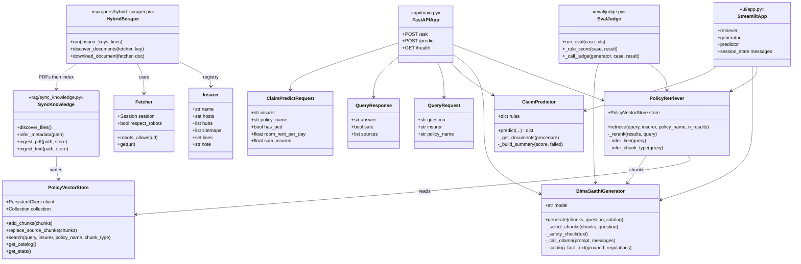
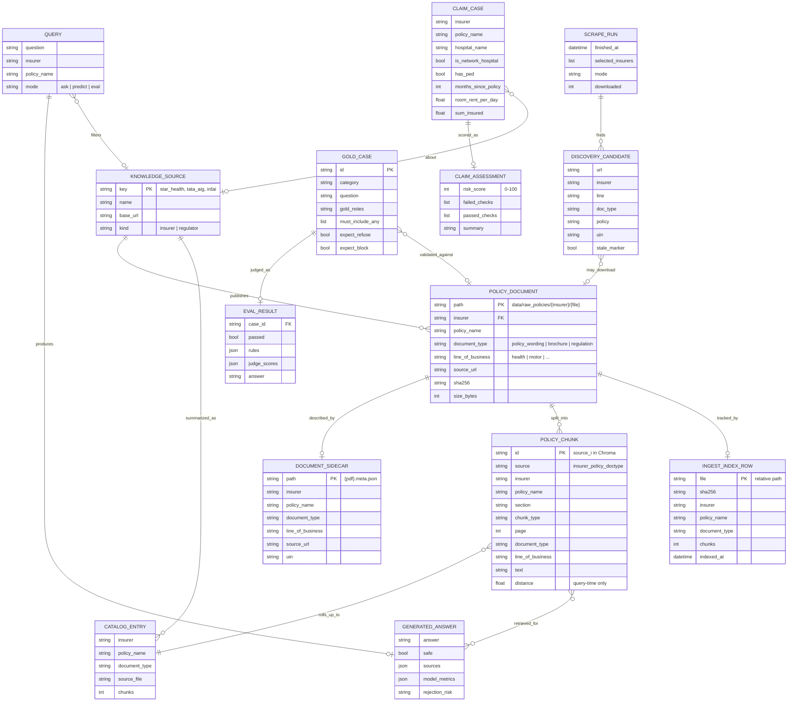

# BeemaSathi — class and entity diagrams

**Visual view:** open [`CLASS_AND_ENTITY_DIAGRAM.html`](CLASS_AND_ENTITY_DIAGRAM.html) in a browser.

Mermaid source (open with a Mermaid preview / VS Code Mermaid extension):

- [`class_diagram.mmd`](class_diagram.mmd)
- [`entity_diagram.mmd`](entity_diagram.mmd)
- [`pipeline_diagram.mmd`](pipeline_diagram.mmd)

They reflect the current Python modules, not an ORM.

---

## 1. Class diagram



---

## 2. Entity-relationship diagram

Logical stores: files under `data/`, ChromaDB, and JSON sidecars / manifests.
There is no SQL database.



---

## 3. How the pieces connect

```
official insurer site
        │
        ▼
hybrid_scraper ──► data/raw_policies/{insurer}/*.pdf + .meta.json
        │
        ▼
sync_knowledge / ingest_pdf ──► data/chunks/*.json
        │                         data/chunks/ingest_index.json
        ▼
PolicyVectorStore (ChromaDB) ──► POLICY_CHUNK + CATALOG_ENTRY
        │
        ├── PolicyRetriever.retrieve()
        │         │
        │         ▼
        └── BimaSaathiGenerator.generate() ──► Streamlit / FastAPI / eval judge
                                                      │
                                                      └── ClaimPredictor.predict()
```

| Store | Path | Entity |
| --- | --- | --- |
| Raw PDFs / HTML text | `data/raw_policies/`, `data/raw_pdfs/` | POLICY_DOCUMENT |
| Sidecar | `*.meta.json` | DOCUMENT_SIDECAR |
| Scrape manifest | `data/raw_policies/manifest.json` | SCRAPE_RUN, DISCOVERY_CANDIDATE |
| Ingest ledger | `data/chunks/ingest_index.json` | INGEST_INDEX_ROW |
| Vector index | `data/chroma_db/` | POLICY_CHUNK |
| Gold set | `eval/gold_cases.json` | GOLD_CASE |
| Eval report | `eval/reports/latest.json` | EVAL_RESULT |
